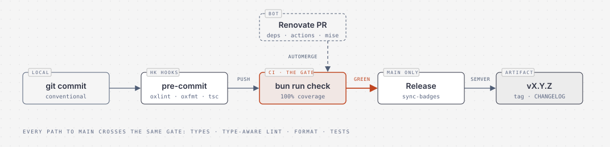

# Contributing

Thanks for helping out. This repo is small on purpose; changes should keep it that way.



## Setup

```sh
mise install          # bun, node, hk, pkl at the versions in mise.toml
mise run setup        # bun install --frozen-lockfile + hk git hooks
```

> [!NOTE]
> On Windows, enable Developer Mode and run `git config core.symlinks true` so `CLAUDE.md` checks
> out as a link to `AGENTS.md`.

## The loop

1. Branch from `main`.
2. Make the change **with its test**, next to the module (`src/foo.ts` → `src/foo.test.ts`).
3. Run the gate until it is green:

   ```sh
   bun run check
   ```

   It runs `tsc` (TypeScript 7), `oxlint --deny-warnings` with type-aware rules, `oxfmt --check`,
   and `bun test` with a **100 %** coverage threshold. `bun run format` fixes formatting.

4. Commit with a [conventional commit](https://www.conventionalcommits.org/):

   ```sh
   git commit -m "fix(weather): handle empty daily arrays"
   ```

   hk runs oxlint and oxfmt on the staged files, type-checks the project with `tsc`, checks
   workflows (actionlint, zizmor), shell scripts (shellcheck) and docs links (lychee), and lints
   the message with commitlint. Allowed types and scopes live in
   [`commitlint.config.ts`](../commitlint.config.ts).

5. Review your own branch structurally before opening the PR:

   ```sh
   mise run review       # difftastic: syntax-aware diff of this branch against main
   ```

6. Open a PR with a conventional-commit **title**: it becomes the squash commit that drives the
   release. The **Conventional title** check lints it, and the PR is labelled automatically with
   `type: …` and `release: major | minor | patch | none`, so you see what merging will release
   before you merge. Edit the title and the labels follow.

   CI's **Quality gate** runs every check as its own step. tsc, oxlint, actionlint and zizmor
   report straight onto the changed lines in the PR's **Files changed** tab, so you rarely need to
   open a log. Renovate PRs go through the same gate.

## Design rules

The full list lives in [AGENTS.md](../AGENTS.md). The short version:

- Logic lives in **pure functions** that take their inputs, including the clock, as parameters.
  I/O sits in a thin shell around them.
- External data passes through **one Zod schema** that transforms it into the domain type.
- Network calls go through `fetchWithRetry()`.
- Types come from data: `as const satisfies`, derived unions, no hand-maintained duplicates.

## Releases

PRs are squash-merged, so **the PR title is the release commit**. Write it as a conventional
commit: `feat(weather): …` releases a minor, `fix`/`perf`/`security`/`chore(deps)` a patch, and a
`!` (or `BREAKING CHANGE:` in the body) a major. Other types release nothing.

On merge, CI runs the gate, then semantic-release creates the `vX.Y.Z` tag and a
[GitHub Release](https://github.com/tashfiqul-islam/profile-weather-view/releases) with notes
generated from the commits. Nothing is committed back to `main`, so there are no versions or
changelogs to edit by hand.
