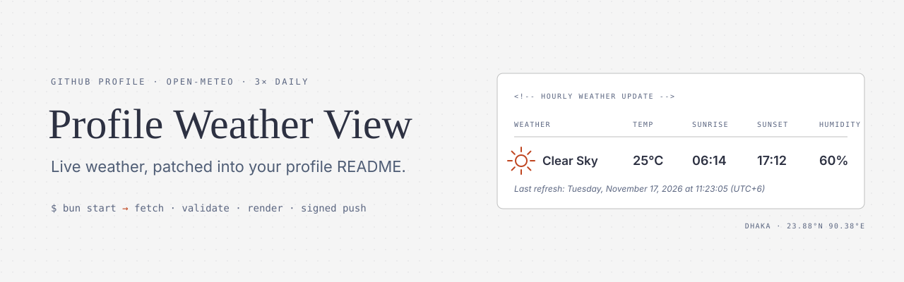
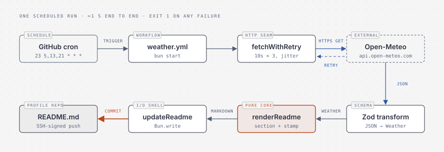

[](https://github.com/tashfiqul-islam/profile-weather-view/actions/workflows/ci.yml)
[](https://github.com/tashfiqul-islam/profile-weather-view/actions/workflows/weather.yml)
[](https://github.com/tashfiqul-islam/profile-weather-view/releases)
[](#development)
[](renovate.json)
[](LICENSE)

[](https://www.typescriptlang.org/)
[](https://bun.sh)
[](https://zod.dev)
[](https://tc39.es/proposal-temporal/docs/)
[](https://oxc.rs/docs/guide/usage/linter)
[](https://oxc.rs/docs/guide/usage/formatter)
[](https://semantic-release.gitbook.io/)

Badges read `package.json` and `mise.toml` on `main` live, so they never drift.

**[How it works](#how-it-works) · [Use it on your profile](#use-it-on-your-profile) · [Configuration](#configuration) · [Development](#development) · [Security](.github/SECURITY.md) · [Releases](https://github.com/tashfiqul-islam/profile-weather-view/releases)**

---

Three times a day a GitHub Actions cron fetches the current weather for Dhaka from
[Open-Meteo](https://open-meteo.com/) (free, no API key), renders it into a marked section of
[my profile README](https://github.com/tashfiqul-islam/tashfiqul-islam), and pushes an SSH-signed
commit. One run takes about a second; any failure exits non-zero and shows up red.

- **Resilient.** Up to three attempts, 10 s each (body included), with jittered backoff on
  dropped sockets, timeouts, 408, 429 and 5xx, honouring `Retry-After`.
- **Validated.** One Zod schema checks the response and transforms it into exactly what the
  README shows.
- **Layout-aware.** Patches either an HTML `<table>` or a Markdown pipe table, in place.
- **Tight.** One runtime dependency (`zod`); native `Temporal`; 100 % test coverage on a
  ~200-line core.

## How it works



Each module is a **pure core** behind a thin **I/O shell**: `renderReadme()` takes the README
text, the weather and the clock, and returns the new text; `updateReadme()` only reads and writes
the file. The network sits behind one seam, `fetchWithRetry()`.

| Module             | Role                                                                |
| ------------------ | ------------------------------------------------------------------- |
| `src/index.ts`     | Entry point: validates the path, orchestrates, sets exit code       |
| `src/weather.ts`   | Open-Meteo request + Zod schema → `Weather`                         |
| `src/http.ts`      | Timeout, retry and backoff policy                                   |
| `src/meteocons.ts` | WMO weather code → [Meteocons](https://bas.dev/work/meteocons) icon |
| `src/readme.ts`    | Section detection and rendering (HTML or Markdown)                  |
| `src/time.ts`      | `Temporal` clock, offset and timestamp formatting                   |

## Use it on your profile

Three steps from fork to a live table:

```text
+------------------- [ SETUP ] --------------------+
|                                                  |
| 1  Mark the section                              |
|    Add the markers to your profile README.       |
| │                                                |
| 2  Fork and point it at you                      |
|    Coordinates in src/config.ts, repo in         |
|    .github/workflows/weather.yml.                |
| │                                                |
| 3  Add secrets, run once                         |
|    Trigger Weather from the Actions tab.         |
|                                                  |
+--------------------------------------------------+
```

The markers, with either layout inside. HTML cells are rewritten in place with their attributes
kept; a Markdown pipe table works too (every row after the header and separator is refilled):

```html
<!-- Hourly Weather Update -->
<table>
  <tr>
    <th>Weather</th>
    <th>Temperature</th>
    <th>Sunrise</th>
    <th>Sunset</th>
    <th>Humidity</th>
  </tr>
  <tr>
    <td align="center"></td>
    <td align="center"></td>
    <td align="center"></td>
    <td align="center"></td>
    <td align="center"></td>
  </tr>
</table>
<!-- End of Hourly Weather Update -->
<em>Last refresh: never</em>
```

## Configuration

The **Weather** workflow's `publish` job reads these from the `profile` environment
(Settings → Environments → `profile`):

| Name                  | Kind     | Purpose                                                                   |
| --------------------- | -------- | ------------------------------------------------------------------------- |
| `PAT`                 | secret   | Fine-grained token: profile repo only, _Contents: read and write_, expiry |
| `SIGNING_KEY`         | secret   | Private ed25519 SSH key; its public half is a GitHub **signing** key      |
| `GIT_COMMITTER_NAME`  | variable | Commit author name                                                        |
| `GIT_COMMITTER_EMAIL` | variable | A verified email on your GitHub account, so commits show **Verified**     |

Runtime environment, set by the workflow or by you for a local run:

```text
+-------------------- [ .ENV ] --------------------+
|                                                  |
| *  PROFILE_README_PATH  profile/README.md        |
|    README to patch; must end in .md.             |
|                                                  |
|    NO_COLOR  —                                   |
|    Any value turns off coloured logs.            |
|                                                  |
| * required                                       |
|                                                  |
+--------------------------------------------------+
```

## Development

Tool versions are pinned in [`mise.toml`](mise.toml); git hooks run through [hk](https://hk.jdx.dev).

```sh
mise install && mise run setup                          # bun, hk, pkl + deps + hooks
bun run check                                           # the gate: types · lint · format · tests
PROFILE_README_PATH=/tmp/readme-copy.md bun start       # one real run against a copy
```

`bun run check` is the only definition of done: TypeScript 7 (native `tsgo`), type-aware oxlint
with zero warnings, oxfmt, and `bun test` at **100 % line, function and statement coverage**.
Pushes to `main` release automatically with semantic-release. See
[CONTRIBUTING](.github/CONTRIBUTING.md) for the full loop and [AGENTS.md](AGENTS.md) for the
conventions coding agents follow (`CLAUDE.md` links to it).

## License

[MIT](LICENSE) © Tashfiqul Islam
