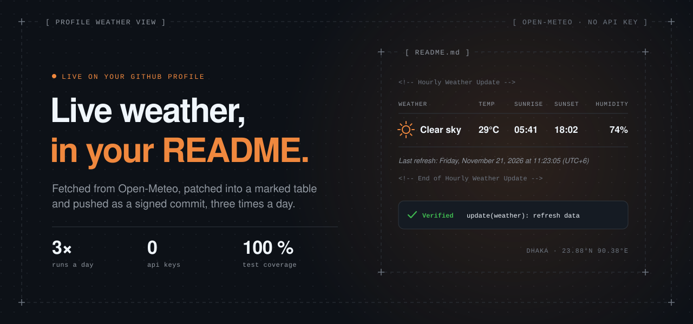
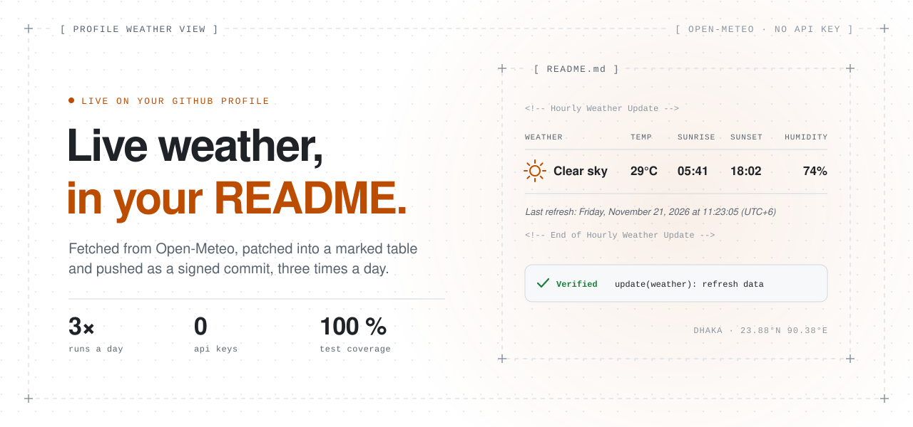
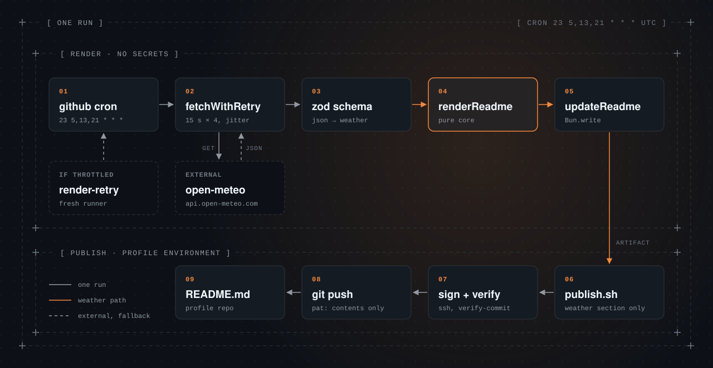
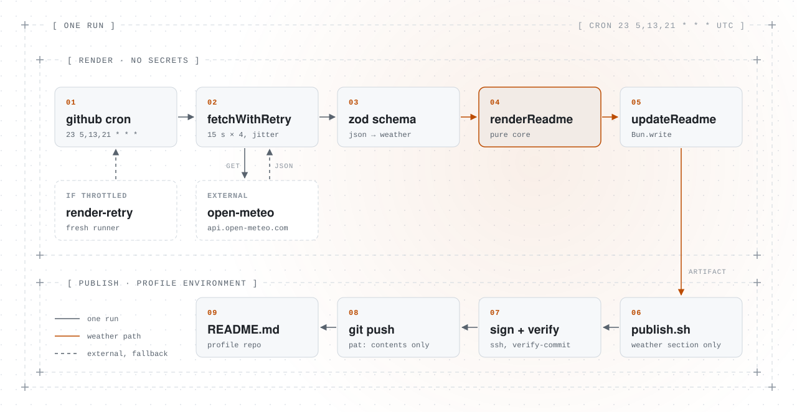

<div align="center">

<a href="https://github.com/tashfiqul-islam/profile-weather-view#gh-dark-mode-only"></a>
<a href="https://github.com/tashfiqul-islam/profile-weather-view#gh-light-mode-only"></a>

### Live weather on your GitHub profile, refreshed three times a day and signed every time

A tiny Bun job that fetches the current weather from [Open-Meteo](https://open-meteo.com/) (free, no
API key), patches a marked table in your profile README, and pushes an SSH-signed commit.

[](https://github.com/tashfiqul-islam/profile-weather-view/actions/workflows/ci.yml)&nbsp;
[](https://github.com/tashfiqul-islam/profile-weather-view/actions/workflows/weather.yml)&nbsp;
[](https://github.com/tashfiqul-islam/profile-weather-view/releases)&nbsp;
[](#development)&nbsp;
[](renovate.json)&nbsp;
[](LICENSE)

**[What you get](#what-you-get) · [Get started](#get-started-in-three-steps) · [How it works](#how-it-works) · [Configuration](#configuration) · [Development](#development) · [Security](.github/SECURITY.md)**

</div>

---

<div align="center">

<table>
  <tr>
    <th>Weather</th>
    <th>Temperature</th>
    <th>Sunrise</th>
    <th>Sunset</th>
    <th>Humidity</th>
  </tr>
  <tr>
    <td align="center">Clear sky </td>
    <td align="center">29°C</td>
    <td align="center">05:41</td>
    <td align="center">18:02</td>
    <td align="center">74%</td>
  </tr>
</table>

<sub>What lands on the profile: an example run. The live one is on <a href="https://github.com/tashfiqul-islam/tashfiqul-islam">my profile</a>.</sub>

</div>

## What you get

One job, one runtime dependency, no API key, and a commit that shows **Verified** on every run. It
either refreshes the table or fails loudly; it never stamps stale weather as fresh.

<details>
<summary><b>See all features</b></summary>
<br />

<table>
<tr>
<td width="50%" valign="top">

### 🌦️ Weather

- **Open-Meteo**: current conditions, sunrise and sunset, humidity; free, no key
- **Meteocons**: every WMO weather code mapped to a day or night icon
- **Your clock**: times rendered in the location's own time zone with native `Temporal`

</td>
<td width="50%" valign="top">

### 🛡️ Resilience

- **Retries**: up to four attempts, 15 s each (body included), jittered backoff
- **Honest errors**: retries dropped sockets, timeouts, 408, 429 and 5xx; honours `Retry-After`
- **Fresh runner**: if the first runner's IP is throttled, a second job retries from a new one

</td>
</tr>
<tr>
<td width="50%" valign="top">

### 🧩 README patching

- **Two layouts**: an HTML `<table>` (attributes kept) or a Markdown pipe table, detected in place
- **Validated**: one Zod schema checks the response and transforms it into the exact cells
- **Loud failures**: missing markers or an empty section exit non-zero, never a silent no-op

</td>
<td width="50%" valign="top">

### 🔐 Publishing

- **Signed commits**: SSH signing, verified with `git verify-commit` before the push
- **Secret seam**: only the publish job sees secrets, inside a protected environment
- **Guarded**: refuses any change outside the weather section and its refresh stamp

</td>
</tr>
<tr>
<td width="50%" valign="top">

### ✅ Quality gate

- **TypeScript 7**: native `tsgo`, strictest flags
- **Type-aware lint**: oxlint with zero warnings, TSDoc enforced on every export
- **100 % coverage**: line, function and statement, enforced by `bunfig.toml`

</td>
<td width="50%" valign="top">

### 🚀 Releases and agents

- **Tag-only releases**: semantic-release from conventional PR titles, labels predict the bump
- **Renovate**: non-major updates automerge once CI is green
- **Agent-ready**: one `AGENTS.md` for every coding agent, `CLAUDE.md` links to it

</td>
</tr>
</table>

</details>

## Get started in three steps

```text
+------------------- [ SETUP ] --------------------+
|                                                  |
| 1  Mark the section                              |
|    Add the markers to your profile README.       |
| │                                                |
| 2  Fork and point it at you                      |
|    Coordinates in src/config.ts, repo in         |
|    .github/workflows/weather.yml.                |
| │                                                |
| 3  Add secrets, run once                         |
|    Trigger Weather from the Actions tab.         |
|                                                  |
+--------------------------------------------------+
```

<details>
<summary><b>The markers</b>, with either layout inside</summary>
<br />

HTML cells are rewritten in place with their attributes kept; a Markdown pipe table works too
(every row after the header and separator is refilled).

```html
<!-- Hourly Weather Update -->
<table>
  <tr>
    <th>Weather</th>
    <th>Temperature</th>
    <th>Sunrise</th>
    <th>Sunset</th>
    <th>Humidity</th>
  </tr>
  <tr>
    <td align="center"></td>
    <td align="center"></td>
    <td align="center"></td>
    <td align="center"></td>
    <td align="center"></td>
  </tr>
</table>
<!-- End of Hourly Weather Update -->
<em>Last refresh: never</em>
```

</details>

> [!TIP]
> The secrets and variables for step 3 are listed under [Configuration](#configuration).

<div align="center">

**[Configuration](#configuration) · [How it works](#how-it-works) · [Security model](.github/SECURITY.md)**

</div>

## How it works

<a href="https://github.com/tashfiqul-islam/profile-weather-view#gh-dark-mode-only"></a>
<a href="https://github.com/tashfiqul-islam/profile-weather-view#gh-light-mode-only"></a>

Each module is a **pure core** behind a thin **I/O shell**: `renderReadme()` takes the README text,
the weather and the clock, and returns the new text; `updateReadme()` only reads and writes the
file. The network sits behind one seam, `fetchWithRetry()`. The full module map is in
[`src/README.md`](src/README.md).

| Module             | Role                                                                |
| ------------------ | ------------------------------------------------------------------- |
| `src/index.ts`     | Entry point: validates the path, orchestrates, sets exit code       |
| `src/weather.ts`   | Open-Meteo request + Zod schema → `Weather`                         |
| `src/http.ts`      | Timeout, retry and backoff policy                                   |
| `src/meteocons.ts` | WMO weather code → [Meteocons](https://bas.dev/work/meteocons) icon |
| `src/readme.ts`    | Section detection and rendering (HTML or Markdown)                  |
| `src/summary.ts`   | The job summary card for each run                                   |
| `src/time.ts`      | `Temporal` clock, offset and timestamp formatting                   |

## Tech stack

<div align="center">

[](https://www.typescriptlang.org/)&nbsp;
[](https://bun.sh)&nbsp;
[](https://zod.dev)&nbsp;
[](https://tc39.es/proposal-temporal/docs/)&nbsp;
[](https://oxc.rs/docs/guide/usage/linter)&nbsp;
[](https://oxc.rs/docs/guide/usage/formatter)&nbsp;
[](https://semantic-release.gitbook.io/)

</div>

Bun runs TypeScript 7 directly, with native `Temporal` and `fetch`; Zod is the only runtime
dependency. Tools are pinned in [`mise.toml`](mise.toml) and git hooks run through
[hk](https://hk.jdx.dev). The badges read `package.json` and `mise.toml` on `main` live, so they
never drift.

## Configuration

The **Weather** workflow's `publish` job reads these from the `profile` environment
(Settings → Environments → `profile`):

| Name                  | Kind     | Purpose                                                                   |
| --------------------- | -------- | ------------------------------------------------------------------------- |
| `PAT`                 | secret   | Fine-grained token: profile repo only, _Contents: read and write_, expiry |
| `SIGNING_KEY`         | secret   | Private ed25519 SSH key; its public half is a GitHub **signing** key      |
| `GIT_COMMITTER_NAME`  | variable | Commit author name                                                        |
| `GIT_COMMITTER_EMAIL` | variable | A verified email on your GitHub account, so commits show **Verified**     |

Runtime environment, set by the workflow or by you for a local run:

```text
+-------------------- [ .ENV ] --------------------+
|                                                  |
| *  PROFILE_README_PATH  profile/README.md        |
|    README to patch; must end in .md.             |
|                                                  |
|    NO_COLOR  —                                   |
|    Any value turns off coloured logs.            |
|                                                  |
| * required                                       |
|                                                  |
+--------------------------------------------------+
```

## Development

```sh
mise install && mise run setup                          # bun, hk, pkl + deps + hooks
bun run check                                           # the gate: types · lint · format · tests
PROFILE_README_PATH=/tmp/readme-copy.md bun start       # one real run against a copy
```

`bun run check` is the only definition of done: TypeScript 7 (native `tsgo`), type-aware oxlint
with zero warnings, oxfmt, and `bun test` at **100 % line, function and statement coverage**.
Pushes to `main` release automatically with semantic-release. See
[CONTRIBUTING](.github/CONTRIBUTING.md) for the full loop and [AGENTS.md](AGENTS.md) for the
conventions coding agents follow.

## Data sources

- **Weather data** by [Open-Meteo](https://open-meteo.com/), licensed
  [CC BY 4.0](https://creativecommons.org/licenses/by/4.0/).
- **Icons**: [Meteocons](https://github.com/basmilius/weather-icons) by Bas Milius, MIT.

## License

[MIT](LICENSE) © Tashfiqul Islam

---

<div align="center">
<sub>Made in Dhaka · refreshed at 05:23, 13:23 and 21:23 UTC</sub>
</div>
